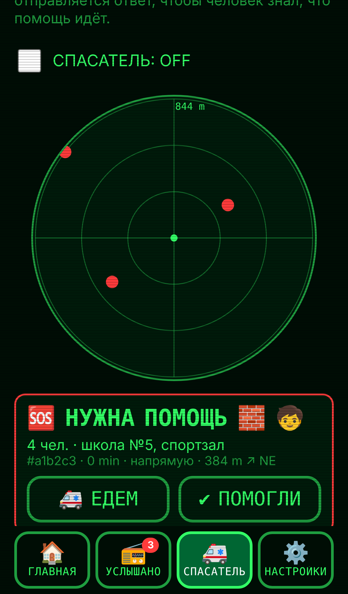

# 📞 Dial-Up Lifeline

**The 1990s modem screech, resurrected to save lives.**
When the internet, the cell network and the power are all gone, Dial-Up Lifeline lets any phone send an SOS to every phone nearby, **as sound**.

> Kiroween 2026 · Category: **Resurrection** · Built with [Kiro](https://kiro.dev)
>
> **▶ Live app: https://dialup-lifeline.vercel.app** (open on two devices: LISTEN on one, I NEED HELP on the other; a third device in between relays it)



## Why

In earthquakes, floods, wildfires and blackouts, cell towers fail first, at the exact moment people need to say *"I'm alive"* or *"3 of us are trapped, we need water"*.
Existing offline tools need a special app installed in advance, Bluetooth pairing or dedicated hardware.

Every phone already has a speaker and a microphone. In the 1980s that was enough to connect the world: the **Bell 202 modem** at 1200 baud.
We brought it back from the dead.

## What it does

| | |
|---|---|
| 🆘 **One-tap SOS** | Pick your situation (trapped, injured, fire, water, medicine, children, elderly), the number of people and a landmark. The phone screeches a compact packet with your GPS. |
| 📻 **Every phone is a receiver** | Any phone in earshot decodes the tones, shows distance and direction to the caller, and stores the message offline. |
| 🔗 **Every phone is a relay** | A phone that hears an SOS it hasn't seen repeats it 2-8 s later, one hop further (up to 7), so a call for help travels block to block. Duplicates are suppressed, phones listen before they talk, and the rescuer's ACK hops back the same way. |
| 🚑 **Rescue Mode** | Rescuers see every call on a radar, **sorted by urgency** (trapped > injured > fire > medicine, then people count and waiting time). An automatic **ACK** tells the sender *"Rescuers heard you"*; the rescuer can then broadcast *ON THE WAY* or *RESOLVED*. |
| 🔁 **Repeat until answered** | The SOS repeats every 60 s until an ACK is heard. The app never claims a message arrived unless it heard the answer. |
| 🌍 **6 languages** | English, Русский, Қазақша, Español, Türkçe, 日本語. Huge buttons, icons and plain wording for people under stress. |
| 🎓 **Drill mode** | Schools and neighbourhood groups can practise; drill messages are clearly tagged and never mixed with real calls. |
| 📲 **Works offline** | An installable PWA. Open it once and it works with no internet, no SIM, no account, no pairing. |

## How it works

```
 SOS form ─► message codec ─► HDLC frame + CRC-16/X.25 ─► NRZI ─► AFSK 1200/2200 Hz ─► 🔊
                                                                                       │ air
 radar / inbox ◄─ codec ◄─ CRC check ◄─ HDLC deframer ◄─ NRZI ◄─ correlator + 2nd-order PLL ◄─ 🎤 (AudioWorklet)
```

- **Modem:** Bell 202 AFSK at 1200 baud, continuous-phase modulator, delay-domain quadrature correlator, second-order PLL for clock recovery (it survives ±2% clock skew between two cheap phones).
- **Framing:** HDLC flags and bit stuffing, NRZI, CRC-16/X.25. This is the same link layer ham-radio APRS uses, so a phone held to a walkie-talkie can carry the packet for kilometres.
- **App:** TypeScript + Vite, no framework, AudioWorklet microphone tap (echo cancellation, noise suppression and AGC disabled), IndexedDB, service worker.

## Built with Kiro

The whole project is driven by Kiro specs. You can find them in [`/.kiro`](.kiro):

- **Specs** in EARS format: `modem-core`, `mesh-relay`, `lifeline-app` (requirements → design → tasks).
- **Steering:** `product`, `tech`, `structure`, and `modem-dsp`, which loads only when DSP files are open (`fileMatch: src/modem/**`).
- **Hooks:**
  - `dsp-property-tests` re-runs the property tests on every modem file save;
  - `i18n-sync` keeps the 6 languages in step;
  - `a11y-review` checks UI changes for stress-readability.

**Property-based tests caught real bugs:**

1. The HDLC deframer leaked a flag bit into the payload. The fixed-vector unit tests passed, but the round-trip property failed. Kiro fixed it with a `pendingZero` lookahead.
2. A clock-skew property was *vacuous*: it cancelled its own skew. Once the model was corrected, a 56-case gain sweep exposed an inverted PLL integrator sign. Now the PLL holds a lock at ±2% skew with noise.

See [`docs/kiro-devlog.md`](docs/kiro-devlog.md) for the full story.

## Run it

```bash
npm install
npm run dev      # open on two phones/laptops, tap LISTEN on one, SOS on the other
npm test         # 150 tests incl. fast-check properties, a mesh simulator and an end-to-end SOS over the modem
npm run build
```

Tip: use speakers at medium volume and keep the devices within 1 to 3 m for the first test.

## Roadmap

- ✅ Done: compact 17-byte binary packet, mesh relay, 300-baud robust mode.
- Radio Bridge mode for walkie-talkies.
- Offline map tiles in Rescue Mode; CSV export for coordinators.

## License

[MIT](LICENSE)
